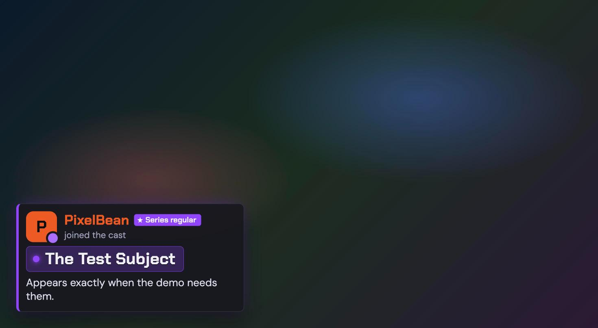
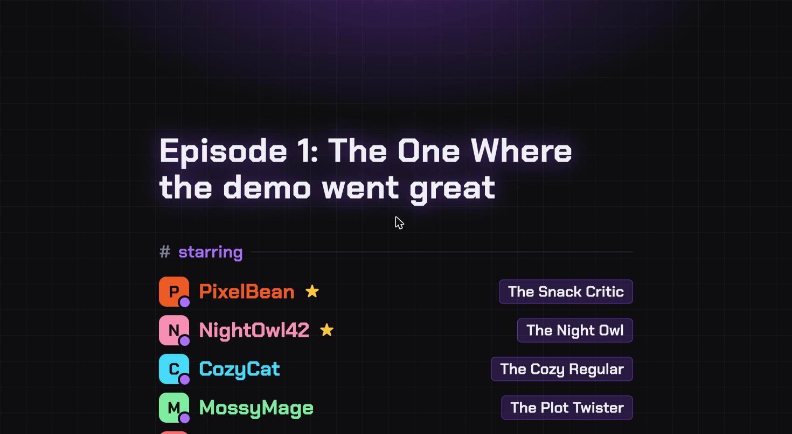
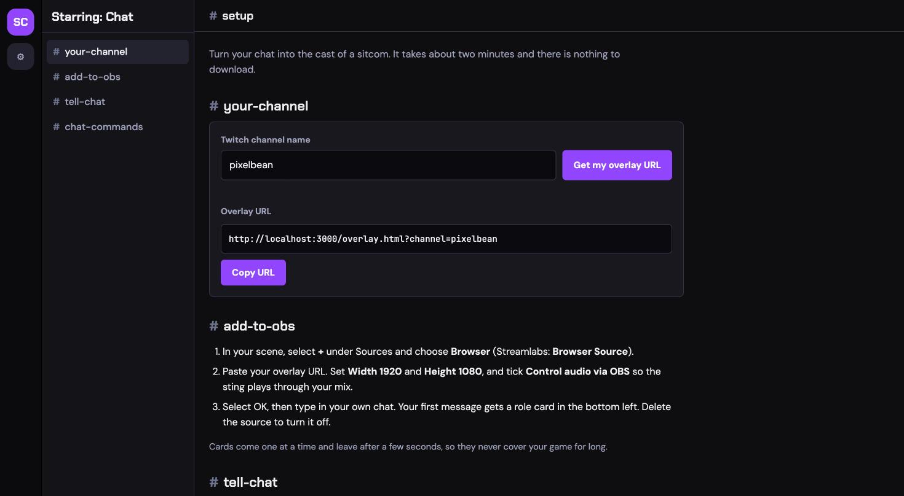
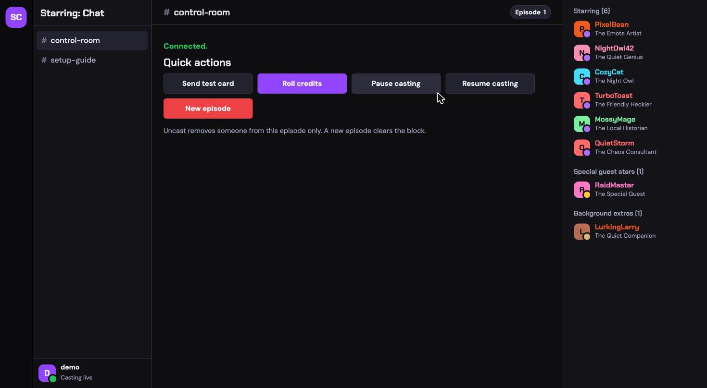

# Starring: Chat

**Turn a small stream's chat into the cast of a sitcom.**

Most Twitch tools celebrate people who pay, or need a crowd to be fun. A stream with 5 to 80 viewers gets nothing built for it: the regular who is there every Tuesday, the friend who backseats every game, the lurker who never types but never misses a stream. Starring: Chat is built for them.

- A chatter's first message gets them **cast**: an AI casting director writes a playful role ("@pixelbean as **The Snack Critic**") and a one-line logline, and an illustrated role card slides onto the stream.
- `!lurk` makes a lurker a **Background Extra**. A raider arrives as a **Special Guest Star**. Chatters who keep coming back become **Series Regulars** from their 3rd episode.
- `!credits` rolls **sitcom end credits** with an AI-written episode title and everyone who showed up.
- It is better at small scale: in a 6-viewer stream every viewer gets a card.

It installs as one OBS browser-source URL. Nothing to download for the streamer.



| End credits (a channel log) | Streamer setup page |
| --- | --- |
|  |  |



The look borrows from the two places this lives: Twitch chat (per-user name colors, badges, violet) and Discord (a role is exactly what the casting director hands out, so a cast card is styled like a member joining with a role chip, status dot and `#channel` headings).

## Try it in one minute (no Twitch account, no API keys)

Requires Node 20 or newer.

```bash
git clone https://github.com/Danh295/starring-chat.git
cd starring-chat
npm install
npm test          # offline, a few seconds
npm run demo      # scripted show: 6 chatters, a lurker, a raid, then !credits (~3 minutes)
```

Then open **http://localhost:3000/overlay.html?channel=demo&preview=1** (`demo` is the default demo channel; change it with `DEMO_CHANNEL`). The scripted show starts when the overlay opens. To replay it, wait until it has finished (about a minute after the credits event) and reload the page; reloading during a run does not restart it. `preview=1` adds a dark stand-in "game" backdrop so you can see the overlay in a normal browser tab; in OBS leave it off for a transparent background.

Note: if `DEMO_CHAT=true` is left in your `.env`, plain `npm start` also runs the demo instead of reading Twitch chat.

Without an OpenAI key, roles come from an editable fallback list (`data/fallback-roles.json`). With a key, the AI writes them.

Other things to poke at while the server runs (from the same machine):

- `http://localhost:3000/test/cast?channel=demo&user=Pixel&kind=guest` (also `kind=lurk`, `regular=1`) sends a single card.
- `http://localhost:3000/test/credits?channel=demo&n=40` rolls sample credits (`n` up to 80; above 30 the credits switch to a compact layout so everyone fits).
- `http://localhost:3000/setup.html` is the streamer-facing guide.
- `http://localhost:3000/control.html?channel=demo` is the control room (set `CONTROL_PASSWORD` in `.env` first).

## Features

| | |
| --- | --- |
| Casting | Once per episode, on a viewer's first message. Never the broadcaster, the bot, known bots (Nightbot, StreamElements, Streamlabs, Moobot, Fossabot, SoundAlerts, WizeBot), links, or other bots' `!commands`. |
| AI roles | OpenAI Responses API with structured output. The chat message is moderated first, the output is validated (role starts with "The", 2 to 4 words; logline under 12 words; no links or @mentions) and moderated again. If anything is slow (3 second budget), flagged, invalid or the key is missing, a role from `data/fallback-roles.json` is used. |
| Memory | `data/cast-<channel>.json` remembers how many episodes each person has appeared in. Series Regular from the 3rd episode. A quick restart resumes the same episode instead of double-counting. |
| Cards | Discord-style "member joined" card with a Twitch-coloured name, avatar tile, status dot and a role chip, revealed after a "Casting director is typing" indicator. Guest Stars are gold, Background Extras are muted, Series Regulars get a Twitch-style badge. Big type for phone viewers. |
| Pacing | At most one card per 8 seconds per channel. Cards queue, nobody is skipped. At most 40 cast per episode. |
| Credits | `!credits` (broadcaster or mod): AI episode title ("Episode 3: The One Where ..." with a fixed fallback), Starring (regulars first), Special Guest Stars, Background Extras, Directed by, Casting by. About 45 seconds. |
| Streamer tools | `/setup.html` (overlay URL, OBS steps, paste-able chat notice) and a password-protected `/control.html` (test card, roll credits, pause, resume, new episode, uncast). |
| Chat reading | Twitch EventSub over WebSocket, with `session_reconnect` migration, keepalive watchdog and backoff. Optional anonymous IRC fallback (`CHAT_SOURCE=irc`). |
| Sharing | `npm run tunnel` wraps a free Cloudflare quick tunnel so a streamer's OBS can load an overlay served from your laptop. |

### Chat commands

| Command | Who | Effect |
| --- | --- | --- |
| `!lurk` | anyone | Cast as a Background Extra |
| `!nocast` | anyone | Opt out: card removed, history deleted, never cast again |
| `!credits` | broadcaster, mods | Roll the end credits |
| `!newepisode` | broadcaster, mods | Start a fresh episode with a clean cast |
| `!uncast @name` | broadcaster, mods | Remove someone from this episode |

## How it works

```
Twitch chat ──EventSub WebSocket──▶ eventsub.js ─┐
(or anonymous IRC)                   irc.js ─────┤
demo.js (scripted chat) ─────────────────────────┤
                                                 ▼
                                          casting.js  ◀── roles.js ──▶ OpenAI (moderation + Responses API)
                                  (who gets cast, episodes,        └─ fallback-roles.json
                                   opt-outs, persistence)
                                                 │ events
                                                 ▼
                                    pacer.js (1 card / 8 s, queued)
                                                 ▼
                                    hub.js  ──WebSocket──▶ public/overlay.html  (OBS browser source)
```

`src/runtime.js` wires everything together; every module takes its dependencies (fetch, WebSocket, OpenAI client, clock) as arguments, which is what makes the test suite fast and offline.

| Module | Job |
| --- | --- |
| `auth.js` | Twitch OAuth code flow, token store (owner-only file), single-flight refresh, localhost-only `/auth` |
| `eventsub.js`, `irc.js`, `chat.js` | Chat readers and the choice between them |
| `casting.js`, `roles.js`, `category.js`, `announce.js` | The casting director and its helpers |
| `credits.js`, `pacer.js`, `demo.js` | Credits, card pacing, scripted demo |
| `hub.js`, `app.js`, `control.js`, `guard.js` | Overlay WebSocket, HTTP app, control API, password and rate-limit guards |
| `public/` | Overlay, setup and control pages (plain HTML/CSS/JS, no framework) |

## Run it for real

### 1. Twitch app and bot account

Follow [docs/twitch-setup.md](docs/twitch-setup.md): register an app at the Twitch developer console (redirect URL `http://localhost:3000/auth/callback`), copy the client ID and secret, then log in once as the bot account at `http://localhost:3000/auth`. Tokens are saved to `data/tokens.json` (gitignored, owner-only) and refresh automatically.

### 2. Configure

```bash
cp .env.example .env     # then edit .env
```

| Variable | Meaning |
| --- | --- |
| `TWITCH_CLIENT_ID`, `TWITCH_CLIENT_SECRET` | From the Twitch developer console |
| `BOT_USERNAME` | The account that reads chat (log in as it at `/auth`; a different account is rejected) |
| `CHANNELS` | Comma-separated channels to join |
| `CHAT_SOURCE` | `eventsub` (default) or `irc` (anonymous, read-only backup) |
| `OPENAI_API_KEY` | Optional. Without it, roles come from `data/fallback-roles.json` |
| `OPENAI_MODEL`, `OPENAI_REASONING_EFFORT` | Model for roles and titles (the default `gpt-5-mini` is a placeholder: set whichever model your account has; a fast, cheap one works best). Effort is only for reasoning models (`minimal` is fastest) |
| `CONTROL_PASSWORD` | Required for `/control.html`; also unlocks `/test/*` through a tunnel |
| `ANNOUNCE_IN_CHAT` | `true` posts "Now starring @user as The Role" (needs the `user:write:chat` scope) |
| `CARD_INTERVAL_MS`, `MAX_CAST` | Card spacing (default 8000) and cast cap per episode (default 40) |
| `DEMO_CHAT`, `DEMO_SPEED`, `DEMO_CHANNEL` | Scripted demo, its speed multiplier, and its channel name |
| `PORT`, `DATA_DIR` | Server port (3000) and where JSON data lives |

### 3. Start, share, add to OBS

```bash
npm start                # the server
npm run tunnel           # optional: a public https URL for streamers (see docs/tunnel.md)
```

Open `/setup.html` (through the tunnel URL if the streamer is on another computer), enter the channel, and paste the overlay URL into an OBS Browser Source: 1920x1080, "Control audio via OBS" on. Details and caveats (the URL changes when the tunnel restarts): [docs/tunnel.md](docs/tunnel.md).

### Is the AI actually writing the roles?

Each cast is logged as one line: `Cast @login as The Role in channel (how)`. `how` is `ai` when the model wrote the role, `fallback: <reason>` when the fallback list was used (reasons: `no-client` for no API key, `timeout`, `flagged`, `invalid`, `output-flagged`, `error`), or `lurk` / `guest` for `!lurk` and raid casts, which never call the model. If you see `timeout`, try a faster model or `OPENAI_REASONING_EFFORT=minimal`. Chat text is never logged.

In a normal browser tab the sting and theme stay silent until you click the page (browser autoplay rules); OBS browser sources are not affected.

## Bring your own art and audio

The default card, stamp, sting and theme are drawn with CSS/SVG and synthesized in the browser, so the project ships with no copyrighted assets. Drop your own files in to replace them: see [public/art/README.md](public/art/README.md) and [public/audio/README.md](public/audio/README.md).

## Privacy, safety and moderation

- **Opt-out**: anyone can type `!nocast`. Their card is removed, their history is deleted from `data/cast-<channel>.json`, and they are never cast again in that channel. Streamers can paste a one-line notice from the setup page.
- **What goes to OpenAI**: only the first chat message of a viewer, the stream category and (for credits) the cast's role names. It is moderated before use, treated as untrusted data in the prompt, and never includes a user name. Without a key nothing is sent.
- **PG by design**: the prompt forbids comments on appearance, identity or anything sensitive; outputs are validated and moderated; the fallback list is hand-written and editable.
- **No chat logging**: chat text is not written to logs or disk. Stored: cast history (login, display name, role, counts) and opt-outs.
- **Security**: tokens never reach the browser; the control password is checked on every control action and rate-limited; `/auth` and `/test/*` are closed through a tunnel; cross-site requests are refused; strict CSP; chat text is rendered with `textContent`. Design notes and corrections to the original plan: [docs/research.md](docs/research.md).

## Development

```bash
npm test         # node:test, offline
```

Modules were written test-first (red, then green), and each ticket was a pull request that went through a code review before merging, with the findings that mattered fixed on the same PR. See the [merged pull requests](https://github.com/Danh295/starring-chat/pulls?q=is%3Apr+is%3Amerged). The suite includes a fake EventSub server, a fake IRC server, and an end-to-end test that boots the whole app in demo mode and asserts that a client receives cards and then credits.

`AGENTS.md` records the project rules for coding agents.

## How this was built

This repository was built in Claude Code with Claude Sonnet and a stronger reviewer model for design checkpoints, following a written plan.

### How Codex was used

> **To be completed by the author before submitting.** The hackathon asks for the Codex thread where most of the project was built and for the thread's session ID (`/status` in Codex). Describe here, in your own words, which parts you built with Codex, what you asked it, and what you changed. Do not claim work that was not done in Codex.

## What's next

A "Previously on" screen from the last episode, channel point recasting, per-channel themes, and a Twitch Extension so any streamer can install it in one click.

## License

MIT, see [LICENSE](LICENSE).
